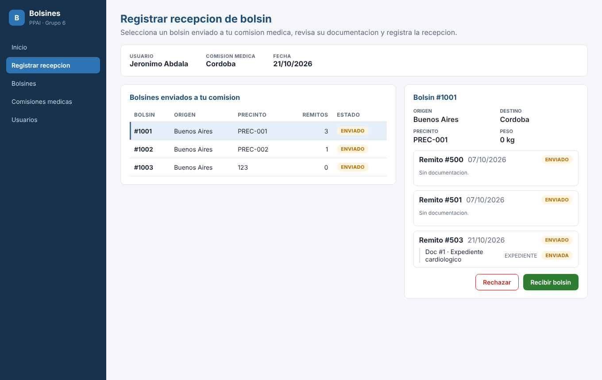

# Sistema Bolsines — PPAI Grupo 6

CU 28 **Registrar recepción de bolsín**, separado en dos proyectos:

| Carpeta | Qué es | Tecnología |
|---|---|---|
| [`backend/`](backend) | API REST. Reutiliza gestor, repositorios, datasources y entidades del proyecto original. | Java 21, Spring Boot 3, SQLite |
| [`frontend/`](frontend) | Interfaz web que consume la API. | React 18, TypeScript, Vite, React Query, React Router |



## Cómo levantarlo

Requisitos: JDK 21 o superior, Maven 3.9+, Node 20+.

```bash
# 1) Backend (http://localhost:8080)
cd backend
mvn spring-boot:run

# 2) Frontend (http://localhost:5173), en otra terminal
cd frontend
npm install
npm run dev
```

Abrí http://localhost:5173. En desarrollo Vite redirige `/api` al backend, así que no hace falta configurar nada.

- La base es `backend/bolsines.db`. Para reiniciar los datos, borrala: se vuelve a crear con datos de prueba al arrancar.
- El usuario logueado se configura en `backend/src/main/resources/application.properties` (`bolsines.usuario-logueado`, por defecto `jero`).
- En IntelliJ: abrí `backend/pom.xml` como proyecto Maven.

## API

| Método | Ruta | Paso del CU 28 / uso |
|---|---|---|
| GET | `/api/recepcion/sesion` | Usuario logueado y su comisión médica |
| GET | `/api/recepcion/bolsines` | Bolsines ENVIADOS hacia la CM del usuario |
| GET | `/api/recepcion/bolsines/{numero}` | Selección del bolsín + información de remitos |
| POST | `/api/recepcion/bolsines/{numero}/recibir` | Registra la recepción (estados en cascada) |
| GET / POST | `/api/bolsines` | Listar / crear bolsín |
| POST | `/api/bolsines/{numero}/remitos` | Agregar remito con documento |
| GET / POST | `/api/comisiones` | Listar / crear comisión médica |
| GET / POST | `/api/usuarios` | Listar / crear usuario |

Los errores vuelven como `{ "mensaje": "..." }` con 400, 404 o 409.

Más detalle de las capas en [ARQUITECTURA.md](ARQUITECTURA.md).
