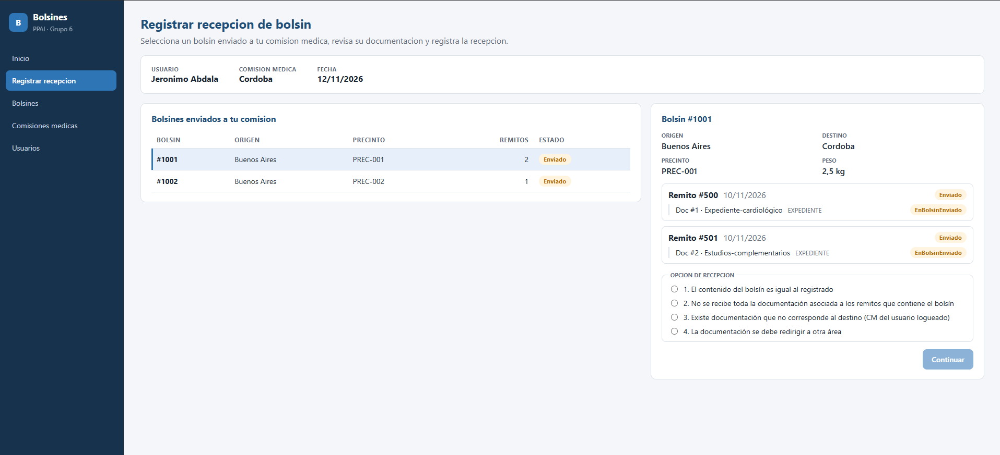

# Sistema Bolsines — PPAI Grupo 6

CU 28 **Registrar recepción de bolsín**, separado en dos proyectos:

| Carpeta | Qué es | Tecnología |
|---|---|---|
| [`backend/`](backend) | API REST con el gestor, los repositorios y las entidades del dominio. | Java 21, Spring Boot 3, Spring Data JPA + Hibernate, H2 |
| [`frontend/`](frontend) | Interfaz web que consume la API. | React 18, TypeScript, Vite, React Query, React Router |



## Requisitos

- **JDK 21** o superior
- **Maven 3.9** o superior
- **Node 20** o superior (incluye `npm`)

## Cómo levantarlo

**1. Backend** — en una terminal, desde la carpeta `backend/`:

```bash
cd backend
mvn clean spring-boot:run
```

Queda en http://localhost:8080. En el log tienen que aparecer `Started BolsinesApplication`, `Datos de prueba: ... cargados` (o `la base ya tiene datos`) y `Sesion iniciada para el usuario 'jero'`.

**2. Frontend** — en otra terminal, desde la carpeta `frontend/`:

```bash
cd frontend
npm ci          # solo la primera vez (instala las dependencias)
npm run dev
```

Abrí http://localhost:5173. En desarrollo Vite redirige `/api` al backend, así que no hace falta configurar nada.

- La base de datos es **H2 en archivo**: se crea sola en `backend/db/` la primera vez que se levanta el backend, con los datos de prueba.
- El usuario logueado se configura en `backend/src/main/resources/application.properties` (`bolsines.usuario-logueado`, por defecto `jero`).
- En IntelliJ: abrí `backend/pom.xml` como proyecto Maven.

## Datos de prueba

| Dato | Valor |
|---|---|
| Usuario logueado | `jero` — Jeronimo Abdala, CM **Cordoba** |
| Otro empleado | `mlopez` — María López, CM **Buenos Aires** (responsable de los envíos) |
| Bolsín 1001 | Buenos Aires → Cordoba, precinto PREC-001, 2,5 kg, remitos 500 y 501 — **Enviado** |
| Bolsín 1002 | Buenos Aires → Cordoba, precinto PREC-002, 1,2 kg, remito 502 — **Enviado** |

## Cómo recorrer el CU 28 en la pantalla

Entrá al menú **Registrar recepcion**. Arriba se ve el usuario logueado (Jeronimo Abdala) y su comisión médica (Cordoba); abajo, los bolsines enviados a esa comisión (1001 y 1002, en amarillo).

**Flujo principal (opción 1)**

1. Hacé clic en el bolsín **1001**: a la derecha se ven su origen, destino, precinto, peso y sus remitos con la documentación.
2. Elegí la opción **1. El contenido del bolsín es igual al registrado** y tocá **Continuar**.
3. En la ventana de confirmación tocá **Confirmar recepcion**.
4. Aparece "Recepcion registrada": el bolsín queda **RecibidoEnCMDestino** (verde), sus remitos **RecibidoYAceptado** y su documentación **RecibidaYAceptada**. Tocá **Listo**.
5. En la tabla queda solo el **1002**: el 1001 ya no está pendiente de recepción.

**Flujo alternativo A6 (cancelar)**

1. Seleccioná un bolsín, elegí la opción 1 y tocá **Continuar**.
2. En la ventana de confirmación tocá **Cancelar**: se cierra la ventana y no cambia nada (el bolsín sigue pendiente).

**Opciones 2, 3 y 4 (no implementadas)**

1. Seleccioná un bolsín y elegí la opción 2, 3 o 4.
2. Tocá **Continuar**: aparece el aviso **"Opción no implementada"** y no cambia nada.

## Cómo reiniciar los datos de prueba

1. Apagá el backend (Ctrl+C en su terminal).
2. Borrá la carpeta `backend/db/`:
   - PowerShell, desde `backend/`: `Remove-Item -Recurse -Force db`
   - Git Bash, desde `backend/`: `rm -rf db`
3. Volvé a levantar el backend: al encontrar la base vacía carga de nuevo los datos de prueba (1001 y 1002 en Enviado).

## Tests

Desde la carpeta `backend/`:

```bash
cd backend
mvn test
```

Corre `RecepcionBolsinFlujoTest`, que recorre el CU 28 completo por la API (sesión, bolsines pendientes, detalle, opciones no implementadas, recepción con la opción 1 e historial de estados). Usa una base H2 **en memoria**, así que no toca los datos de `backend/db/`.

## API

| Método | Ruta | Paso del CU 28 / uso |
|---|---|---|
| GET | `/api/recepcion/sesion` | Usuario logueado y su comisión médica |
| GET | `/api/recepcion/bolsines` | Bolsines en estado Enviado hacia la CM del usuario |
| GET | `/api/recepcion/bolsines/{numero}` | Selección del bolsín + información de remitos |
| POST | `/api/recepcion/bolsines/{numero}/recibir` | Registra la recepción. Cuerpo: `{ "opcion": 1 }` (opción de recepción elegida) |
| GET / POST | `/api/bolsines` | Listar / crear bolsín |
| POST | `/api/bolsines/{numero}/remitos` | Agregar remito con documentación |
| GET / POST | `/api/comisiones` | Listar / crear comisión médica |
| GET / POST | `/api/usuarios` | Listar / crear usuario |

Los errores vuelven como `{ "mensaje": "..." }` con 400 (datos inválidos), 404 (no existe), 409 (el bolsín no está pendiente) o 501 (opción de recepción 2, 3 o 4: no implementada).

Más detalle en [ARQUITECTURA.md](ARQUITECTURA.md) (capas, persistencia, entidades) y [CASO_DE_USO_RECEPCION.md](CASO_DE_USO_RECEPCION.md) (qué clase y método resuelve cada paso del CU 28).
